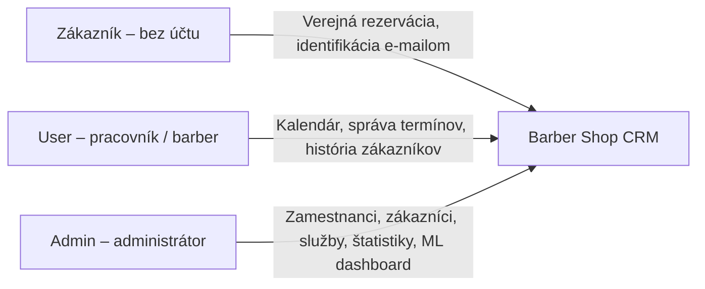
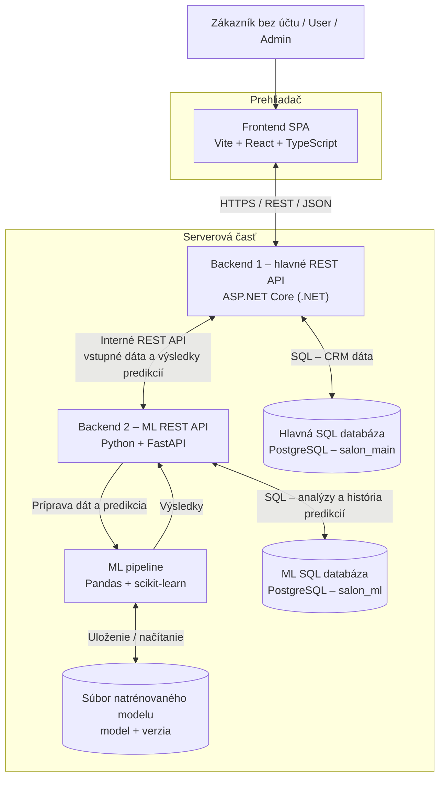
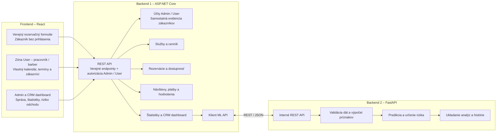
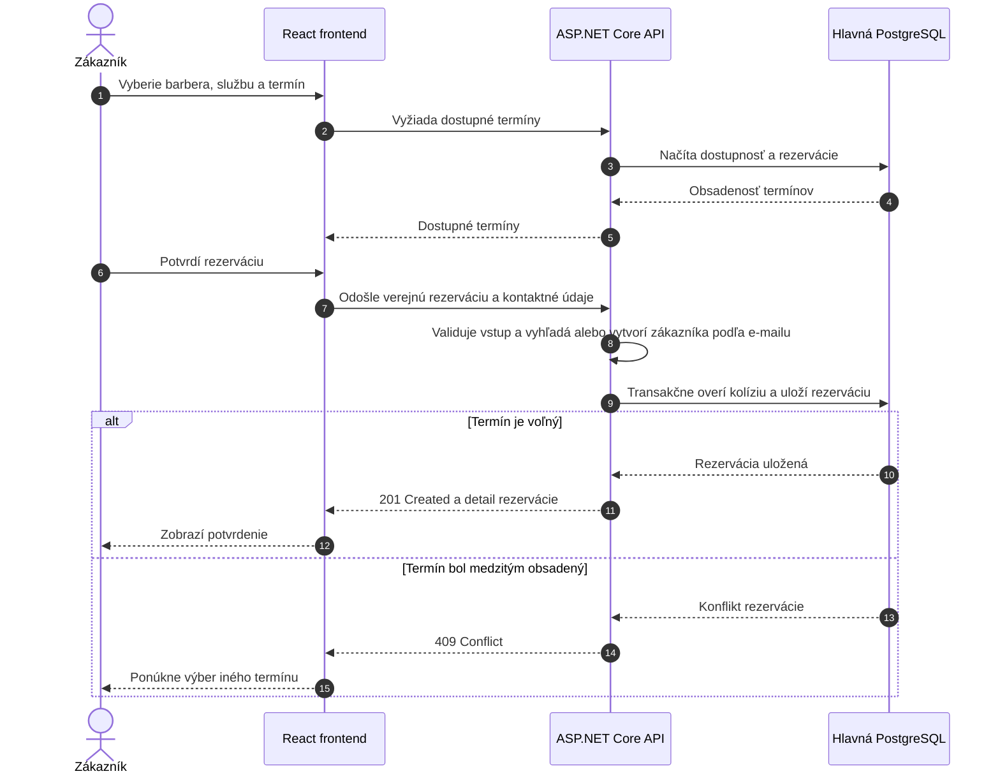
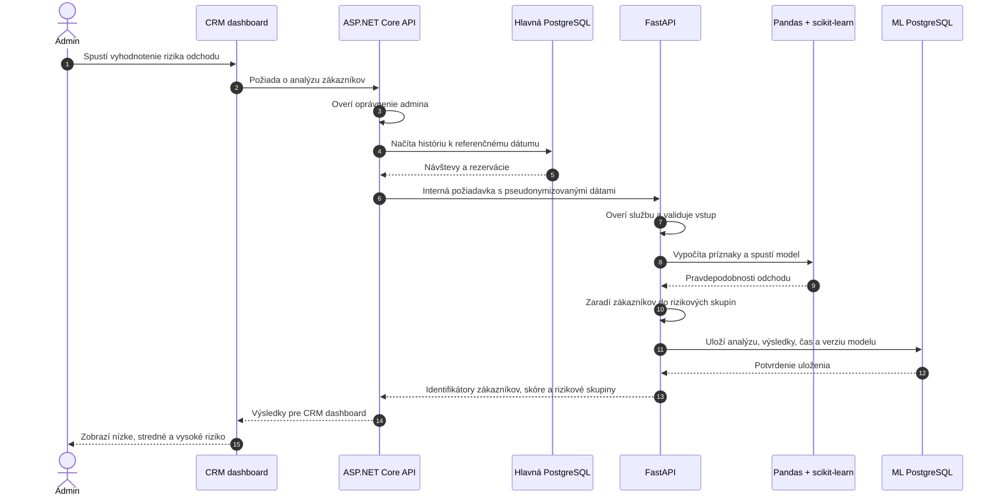
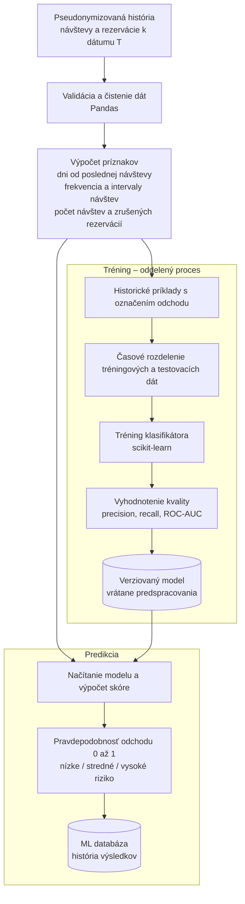
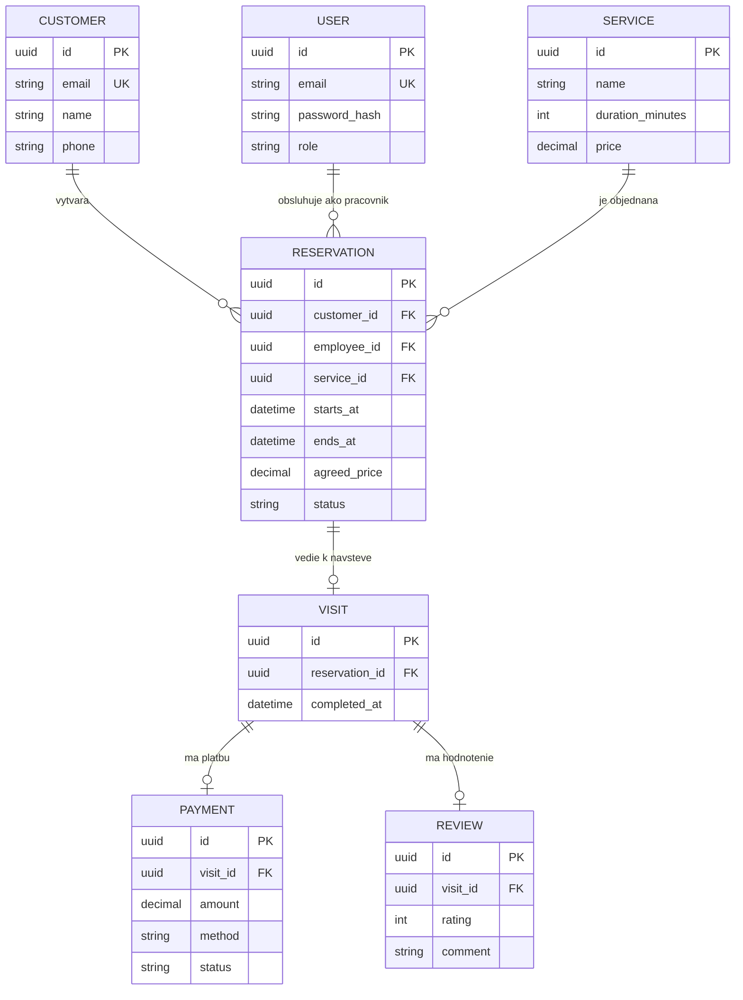
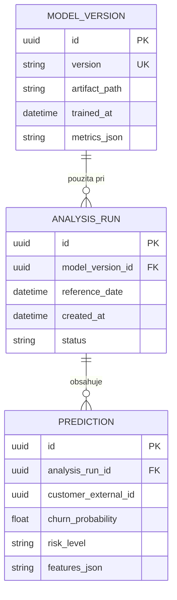
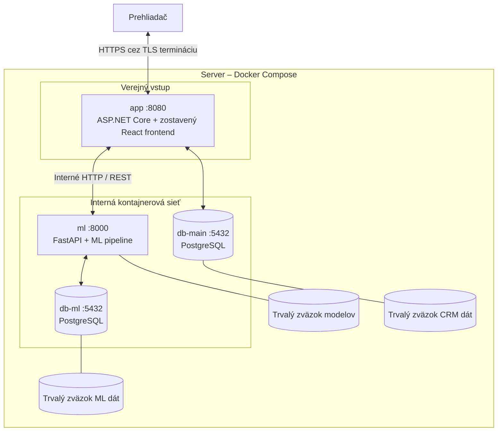

# Architektúra – Barber Shop CRM

## 1. Účel a rozsah

Tento dokument opisuje **navrhovanú architektúru podľa zadania**, nie aktuálny stav implementácie. Systém poskytuje rezervácie, správu zákazníkov a barberov, evidenciu návštev, platieb a hodnotení a predikciu odchodu zákazníkov (Customer Churn Prediction).

> Roly zodpovedajú implementácii v `backend-main/src/SalonCrm.Api/Domain/UserRole.cs`: `Admin` a `User`. Zákazník nemá účet ani používateľskú rolu; rezervuje cez verejný formulár a identifikuje sa e-mailom. Rozdielom oproti existujúcemu návrhu projektu zostáva komunikácia s ML: tento dokument navrhuje volanie cez hlavný backend, kým projekt počíta aj s priamym volaním ML API z frontendu. Dokument nemení implementáciu ani konfiguráciu.

## 2. Kontext systému

## 3. Aplikačná architektúra

- **Frontend** zobrazuje rozhranie podľa roly a komunikuje iba s hlavným backendom. Nepristupuje priamo do databáz ani do ML API.
- **Hlavný backend** je zdrojom pravdy pre CRM. Zabezpečuje autentifikáciu, autorizáciu, obchodné pravidlá a komunikáciu s ML službou.
- **ML backend** vykonáva výhradne analýzy zákazníkov, prípravu dát a ML predikcie. Nespravuje rezervácie ani prihlasovanie používateľov.
- **Každý backend vlastní svoju databázu.** Medzi databázami nie sú priame dotazy, zdieľané tabuľky ani cudzie kľúče; dáta sa prenášajú cez REST API.
- Pre hlavný backend je zo zadaných alternatív zvolený **PostgreSQL**, ktorý používa aj existujúci projekt. MS SQL je možná alternatíva, nie ďalšia potrebná databáza.

## 4. Moduly a zodpovednosti

| Aktér / rola | Hlavné oprávnenia |
|---|---|
| Zákazník (bez účtu a roly) | Verejný výber služby, pracovníka a termínu a vytvorenie rezervácie. Identifikácia normalizovaným e-mailom; nevzniká prihlasovací účet. |
| `User` (pracovník, napr. barber) | Vidí a spravuje iba vlastné termíny a zákazníkov, ktorých obsluhoval. |
| `Admin` | Vidí všetky dáta; spravuje používateľov, zákazníkov, služby a cenník, štatistiky, ML a retenčné akcie. |

Oprávnenia a vlastníctvo dát kontroluje backend pri každej chránenej požiadavke, nie iba frontend. Používateľské účty a ich roly spravuje admin. Pri verejnej rezervácii sa zákazník vyhľadá alebo vytvorí podľa normalizovaného e-mailu; e-mail sám osebe neoprávňuje na prístup k histórii ani na zmeny existujúcich rezervácií. Zákaznícky portál, vlastná história a hodnotenia zo zadania nie sú oprávneniami existujúcej zákazníckej roly, pretože taká rola v kóde neexistuje.

## 5. Tok vytvorenia rezervácie

Kontrola dostupnosti pri zobrazení kalendára nestačí: pred súbežnými rezerváciami chráni aj transakcia a databázové obmedzenie. Zmeny a rušenie rezervácií vykonáva oprávnený pracovník (`User` iba pri vlastných termínoch) alebo `Admin`, pri dodržaní povolených prechodov stavu.

## 6. Tok ML predikcie a zobrazenia výsledkov

Nasledujúci diagram ukazuje navrhované vyhodnotenie na požiadanie admina. Tréning modelu prebieha oddelene od obsluhy tejto požiadavky.

Výsledky možno neskôr načítať z histórie v ML databáze cez rovnakú cestu frontend → hlavný backend → ML backend. Pri nedostupnosti ML služby zostávajú bežné CRM funkcie dostupné; dashboard zobrazí chybu alebo posledný dostupný výsledok s dátumom výpočtu.

## 7. ML pipeline

- **Definícia odchodu:** pred tréningom treba určiť, po akom období bez návštevy sa zákazník považuje za odídeného a aký je horizont predikcie. Zadanie konkrétnu hranicu neurčuje.
- **Ochrana pred únikom dát:** príznaky k dátumu T smú používať iba informácie známe k T. Označenie odchodu sa pri tréningu určuje z nasledujúceho sledovaného obdobia; príklady musia mať dostatočne dlhé následné pozorovanie.
- **Rizikové skupiny:** hranice medzi nízkym, stredným a vysokým rizikom sú konfigurovateľné a majú vychádzať z vyhodnotenia modelu.
- **Interpretácia:** zákazník s obvyklým intervalom návštev 21 dní, ktorý neprišiel 60 dní, môže dostať zvýšené riziko. Nejde o istotu, že zákazník odišiel.
- **Dáta:** bez vhodných historických a označených dát nemožno deklarovať spoľahlivú kvalitu predikcie; syntetické dáta slúžia iba na demonštráciu.

## 8. Konceptuálny dátový model

Diagram zobrazuje hlavné entity a vzťahy, nie finálnu databázovú schému. Pre jednoduchosť predpokladá jednu službu na rezerváciu a najviac jednu platbu a hodnotenie na návštevu.

`USER.role` nadobúda iba hodnoty `Admin` alebo `User`. Pracovník/barber je používateľský účet priradený cez `employee_id`, nie samostatná rola ani entita `BARBER`. `CUSTOMER` je samostatný záznam bez väzby na prihlasovací účet. Ostatné entity zostávajú konceptuálnym návrhom podľa zadania, nie presným prepisom aktuálnej schémy.

Cena dohodnutá v rezervácii uchováva historickú hodnotu aj po zmene cenníka. Platby predstavujú evidenciu platieb; integrácia externej platobnej brány nie je súčasťou zadania.

Samostatná ML databáza:

`customer_external_id` je pseudonymizovaný identifikátor z hlavného backendu, **nie databázový cudzí kľúč** do hlavnej databázy. ML služba nepotrebuje meno, e-mail, telefón ani prihlasovacie údaje zákazníka. Artefakt modelu je uložený v súborovom úložisku; databáza eviduje jeho verziu a metadáta.

## 9. Navrhované nasadenie

Štyri kontajnery zodpovedajú základnému rozdeleniu existujúceho `docker-compose.yml`, ale nižšie uvedený smer volania ML služby vychádza z tohto zadania, nie z aktuálnej konfigurácie.

- Pri vývoji môže Vite bežať samostatne; pri nasadení hlavný backend poskytuje zostavené statické súbory frontendu.
- V produkcii majú byť databázy a ML API dostupné iba interne. Existujúce mapovanie ich portov na hostiteľa slúži vývoju a tento cieľový stav zatiaľ nezaručuje.
- TLS terminácia je požiadavka produkčného prostredia; konkrétny spôsob jej nasadenia tento návrh neurčuje.
- Trvalé zväzky uchovávajú dáta pri výmene kontajnerov, nenahrádzajú však pravidelné zálohy.

## 10. Bezpečnosť a prevádzkové pravidlá

- Prihlásenie účtov `Admin` a `User` spravuje hlavný backend cez serverové sessions a cookie `salon_sid`. V produkcii má cookie používať `HttpOnly`, `Secure` a zodpovedajúcu ochranu proti CSRF. Zákazník verejnú rezerváciu vytvára bez prihlásenia.
- Heslá sa ukladajú iba ako bezpečné hashe. Citlivé nastavenia a prihlasovacie údaje sa odovzdávajú cez konfiguráciu prostredia, nie cez zdrojový kód.
- Interné ML API overuje identitu hlavného backendu, napríklad servisným API kľúčom. Samotná interná sieť nenahrádza autentifikáciu.
- Prenášajú sa iba údaje potrebné na analýzu. Pseudonymizované záznamy zostávajú citlivými údajmi s obmedzeným prístupom a dobou uchovávania.
- Volania ML API majú časový limit a zrozumiteľné chybové odpovede; nedostupnosť ML nesmie zablokovať rezervácie.
- Každá predikcia obsahuje referenčný dátum, čas výpočtu a verziu modelu, aby bolo možné rozlíšiť aktuálne a historické výsledky.
